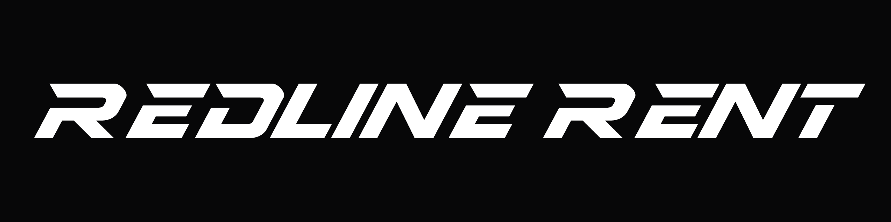

# Ave Display

Wersalikowy krój wystawowy (display) do nagłówków. Zbudowany od zera na literze **R z monogramu RR**:
litera R w foncie to wektor `reference/R-z-monogramu.svg` przeskalowany do metryk fontu, a pozostałe
znaki powstały z tych samych reguł. Dzięki temu logo, ikona i nagłówki na stronie są jednym krojem.



- rodzina **Ave Display**, styl **Regular**: jedna grubość, krój jest pochylony sam z siebie,
- tylko wersaliki; małe litery wskazują na te same glify, więc `redline rent` wyświetli się jako `REDLINE RENT`,
- akapity składamy innym krojem (Geist). Ave Display nie nadaje się do tekstu ciągłego.

## Pliki

| plik | co to jest |
|---|---|
| `dist/AveDisplay-Regular.woff2` | font na stronę (ok. 3 KB) |
| `dist/AveDisplay-Regular.ttf` | ten sam font do instalacji w systemie lub w programach graficznych |
| `specimen.html` | strona prezentacyjna: nagłówki w 140/72/32/16 px, siatka znaków, porównanie ze wzorcem |
| `preview/specimen.png`, `preview/redline-rent.png` | podglądy wyrenderowane przez Chrome bez okna |
| `src/ave_display/` | kod kroju: parametry, geometria, glify, odstępy, składanie fontu |
| `scripts/verify.py` | testy fontu |
| `scripts/preview.py` | render podglądów PNG |
| `scripts/kern_suggest.py` | podpowiedzi wartości kerningu z kształtu glifów |
| `reference/` | materiały wzorcowe (monogram, napisy wzorcowe) |

## Jak zbudować

Wszystko działa w wirtualnym środowisku Pythona w katalogu projektu (`.venv`), więc nic nie trafia do systemu.

```bash
git clone https://github.com/AveJaPl/ave-display.git
cd ave-display
python3 -m venv .venv                          # tylko za pierwszym razem: tworzy lokalne środowisko
.venv/bin/pip install -r requirements.txt      # tylko za pierwszym razem: instaluje biblioteki do .venv
.venv/bin/python build.py                      # buduje font, testuje go i renderuje podglądy
```

`.venv/bin/python` to Python z tego lokalnego środowiska. Nie trzeba niczego aktywować.
Opcje: `--no-check` pomija testy, `--no-preview` pomija render PNG (render wymaga Google Chrome).
Same testy uruchomisz poleceniem `.venv/bin/python scripts/verify.py`.

## Zakres znaków (69 glifów, 104 znaki w cmap)

- `A-Z` oraz `a-z` (te same glify),
- `Ą Ć Ę Ł Ń Ó Ś Ź Ż` oraz `ą ć ę ł ń ó ś ź ż` (te same glify),
- `0-9`,
- `spacja . , : ; - – / ! ? % + & ' " ( ) # @ * · × °`, a także twarda spacja (U+00A0), np. do `1&nbsp;690 ZŁ`,
- `.notdef`.

Kerning: 132 pary glifów (m.in. VA, WA, YA, TA, FA, PA, LT, LV, LY, RT, RV, RY, T. V. Y. P.).
Działa też dla małych liter, bo to te same glify.

## Konstrukcja

Glify są projektowane w układzie pionowym, czyli bez pochylenia, a na końcu pochylane o 28° wokół połowy
wysokości wersalików. Wartości wzorcowe zmierzono na `R-z-monogramu.svg` (wysokość 99,3 → 700 jednostek).

| parametr | wartość | skąd |
|---|---|---|
| UPM / wysokość wersalików | 1000 / 700 | |
| pochylenie | 28° | trzon R |
| trzon | 240 | trzon R |
| belka górna i dolna | 178 | górna belka R |
| belka środkowa R/P | 226-391 | R |
| belki środkowe E, F, H, B, S… | 280-420 | napis wzorcowy (E) |
| bok brzuszka | 230 | brzuszek R |
| noga R (i podobne ukośne) | 45° po pochyleniu, grubość 204 | noga R |
| ścięcie lewego końca belki | 1,108 (ok. 30° „pod prąd”) | górna belka R |
| zaokrąglenia brzuszków | 242×178 i 146×110 (zewn.), 70×54 i 50×36 (wewn.) | krzywe dopasowane do R z błędem ok. 2 j. |
| przerwa w T | 96 | napis wzorcowy |

Reguły wspólne dla całego kroju:

- **Otwarta konstrukcja.** R, P, B, D, E i F mają górną belkę odciętą od trzonu, a lewy koniec belki jest ścięty
  w ostrze. R i P mają ostrze dokładnie jak w logo. E, D, F i B mają je krótsze, tak jak w `napis-wzor-1.png`.
- **Zaokrąglenia tylko na brzuszkach**, czyli na krzywiznach jak prawy bok R. Narożniki, które po pochyleniu są
  ostre (prawy górny, lewy dolny), dostają duży promień z R. Rozwarte dostają mniejszy. Reszta krawędzi jest prosta.
- **Grubość ukośnych kresek jest liczona po pochyleniu**, dzięki czemu V, W, Y, M i X nie chudną po przechyleniu.
- **Odstępy są luźniejsze niż we wzorcu**: napis REDLINE RENT jest ok. 14% szerszy niż `napis-wzor-1.png`
  przy tej samej wysokości liter. Ostrze belki celowo wchodzi w pole poprzedniej litery.

Kod:

- `src/ave_display/params.py`: wszystkie parametry stylu,
- `src/ave_display/geometry.py`: prymitywy (prostokąty, pasy ukośne, wielokąty z zaokrągleniami) i operacje logiczne (skia-pathops),
- `src/ave_display/glyphs/`: `letters.py` (A-Z), `polish.py` (diakrytyki), `digits.py`, `symbols.py`, `base.py`,
- `src/ave_display/spacing.py`: światła boczne i tabela kerningu,
- `src/ave_display/builder.py`: składanie fontu (fontTools `FontBuilder`, kontury TrueType), zapis TTF i WOFF2.

Żeby zmienić krój, zmień parametr albo funkcję glifu i uruchom `build.py`. Testy od razu pokażą, czy coś się popsuło.

## Weryfikacja (`scripts/verify.py`)

- każdy znak z zakresu ma glif w cmap, a małe litery wskazują na wersaliki,
- żaden glif poza spacją nie jest pusty; `.notdef` jest pierwszy,
- kierunek konturów jest zgodny z TrueType i kontury nie nakładają się na siebie,
- `usWinAscent`/`usWinDescent` obejmują wszystkie glify, więc Windows nie przytnie akcentów ani ogonków,
- pary z kerningiem nie zbliżają się na mniej niż 20 j.,
- **litera R pokrywa się z `R-z-monogramu.svg` w 98,7% (IoU)**,
- WOFF2 ma te same glify i cmap co TTF.

## Użycie na stronie

```css
@font-face {
  font-family: "Ave Display";
  src: url("/fonts/AveDisplay-Regular.woff2") format("woff2");
  font-weight: 400;
  font-style: normal;
  font-display: swap;
}

h1, h2, h3 {
  font-family: "Ave Display", sans-serif;
  font-weight: 400;      /* krój ma jedną grubość */
  font-synthesis: none;  /* bez sztucznego pogrubienia i pochylenia */
}
```

Nagłówki mają w przeglądarce domyślnie `font-weight: bold`. Bez dwóch ostatnich linijek przeglądarka dorobi
sztuczne pogrubienie i litery się rozmyją. Jeśli w danym miejscu odstępy będą za luźne, ściśnij je przez
`letter-spacing: -0.02em`.

## Metryki

UPM 1000, wersaliki 700, ascender 950, descender -250, line gap 0, czyli domyślna wysokość wiersza 1,2.
Najwyższy punkt (kreska nad Ć Ń Ó Ś Ź) to 931, najniższy (ogonek Ą Ę) to -185. `italicAngle` = -28°, a nachylenie kursora odpowiada
pochyleniu. Styl jest zapisany jako Regular, bez flagi kursywy. Fontu nie hintowano, bo w rozmiarach nagłówkowych
nie jest to potrzebne.

## Licencja

Font jest własnością **Filipa Piątka (AveJa)**. Wszelkie prawa zastrzeżone. Ta informacja jest wpisana w metadane
fontu (copyright i opis licencji). Bez pisemnej zgody właściciela nie wolno kopiować, rozpowszechniać ani modyfikować.
