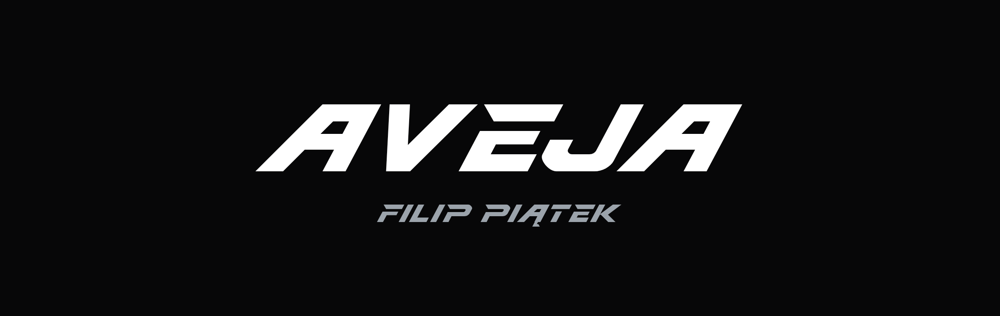
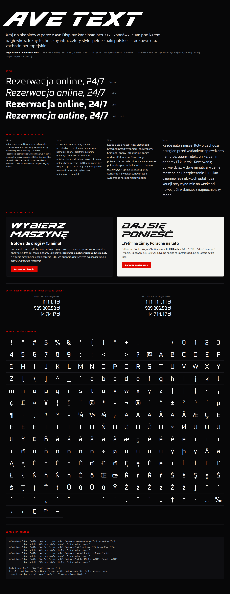

# Ave Display i Ave Text

Dwa kroje Filipa Piątka (AveJa), które tworzą jedną rodzinę: **Ave Display** do nagłówków
i **Ave Text** do akapitów (opis niżej, w sekcji [Ave Text](#ave-text)).

## Pliki

| plik | co to jest |
|---|---|
| `dist/AveDisplay-Regular.woff2` | font na stronę (ok. 3 KB) |
| `dist/AveDisplay-Regular.ttf` | ten sam font do instalacji w systemie lub w programach graficznych |
| `dist/AveText-{Regular,Italic,Bold,BoldItalic}.woff2` | Ave Text na stronę (ok. 18 KB na styl) |
| `dist/AveText-{Regular,Italic,Bold,BoldItalic}.ttf` | Ave Text do instalacji w systemie |
| `specimen.html` | strona prezentacyjna Ave Display: nagłówki w 140/72/32/16 px, siatka znaków, porównanie ze wzorcem |
| `specimen-text.html` | strona prezentacyjna Ave Text: style, akapity 14–24 px, para z Ave Display, cyfry, zestaw znaków |
| `preview/specimen.png`, `preview/text-specimen.png`, `preview/banner.png` | podglądy wyrenderowane przez Chrome bez okna |
| `src/ave_core/` | kod wspólny obu krojów: geometria konturów, zapis TTF/WOFF2, hinting, metadane |
| `src/ave_display/` | kod Ave Display: parametry, geometria, glify, odstępy, składanie fontu |
| `src/ave_text/` | kod Ave Text: style, prymitywy, glify, kerning, cechy OpenType, składanie rodziny |
| `scripts/verify.py`, `scripts/verify_text.py` | testy Ave Display i Ave Text |
| `scripts/preview.py`, `scripts/text_proof.py` | render podglądów PNG i arkuszy kontrolnych Ave Text |
| `docs/superpowers/specs/2026-11-07-ave-text-design.md` | projekt Ave Text: decyzje, pomiary referencji, kamienie milowe |
| `scripts/kern_suggest.py` | podpowiedzi wartości kerningu z kształtu glifów |
| `reference/` | materiały wzorcowe (monogram, napisy wzorcowe) |

## Jak zbudować

Wszystko działa w wirtualnym środowisku Pythona w katalogu projektu (`.venv`), więc nic nie trafia do systemu.

```bash
git clone https://github.com/AveJaPl/ave-display.git
cd ave-display
python3 -m venv .venv                          # tylko za pierwszym razem: tworzy lokalne środowisko
.venv/bin/pip install -r requirements.txt      # tylko za pierwszym razem: instaluje biblioteki do .venv
.venv/bin/python build.py                      # buduje oba kroje, testuje je i renderuje podglądy
```

`.venv/bin/python` to Python z tego lokalnego środowiska. Nie trzeba niczego aktywować.
Opcje: `--family display` albo `--family text` buduje tylko jeden krój, `--no-check` pomija testy,
`--no-preview` pomija render PNG (render wymaga Google Chrome), `--no-hint` buduje Ave Text bez hintingu
(szybciej przy poprawkach). Same testy: `.venv/bin/python scripts/verify.py` (Ave Display)
i `.venv/bin/python scripts/verify_text.py` (Ave Text).

## Ave Display

Wersalikowy krój wystawowy (display) do nagłówków. Zbudowany od zera na literze **R z monogramu RR**:
litera R w foncie to wektor `reference/R-z-monogramu.svg` przeskalowany do metryk fontu, a pozostałe
znaki powstały z tych samych reguł. Dzięki temu logo, ikona i nagłówki na stronie są jednym krojem.



- rodzina **Ave Display**, styl **Regular**: jedna grubość, krój jest pochylony sam z siebie,
- tylko wersaliki; małe litery wskazują na te same glify, więc `redline rent` wyświetli się jako `REDLINE RENT`,
- akapity składamy krojem **Ave Text** z tego repozytorium. Ave Display nie nadaje się do tekstu ciągłego.

### Zakres znaków (69 glifów, 104 znaki w cmap)

- `A-Z` oraz `a-z` (te same glify),
- `Ą Ć Ę Ł Ń Ó Ś Ź Ż` oraz `ą ć ę ł ń ó ś ź ż` (te same glify),
- `0-9`,
- `spacja . , : ; - – / ! ? % + & ' " ( ) # @ * · × °`, a także twarda spacja (U+00A0), np. do `1&nbsp;690 ZŁ`,
- `.notdef`.

Kerning: 132 pary glifów (m.in. VA, WA, YA, TA, FA, PA, LT, LV, LY, RT, RV, RY, T. V. Y. P.).
Działa też dla małych liter, bo to te same glify.

### Konstrukcja

Glify są projektowane w układzie pionowym, czyli bez pochylenia, a na końcu pochylane o 28° wokół połowy
wysokości wersalików. Wartości wzorcowe zmierzono na `R-z-monogramu.svg` (wysokość 99,3 → 700 jednostek).

| parametr | wartość | skąd |
|---|---|---|
| UPM / wysokość wersalików | 1000 / 700 | |
| pochylenie | 28° | trzon R |
| trzon | 240 | trzon R |
| belka górna i dolna | 178 | górna belka R |
| belka środkowa R/P | 226-391 | R |
| belki środkowe E, F, H, B, S… | 280-420 | napis wzorcowy (E) |
| bok brzuszka | 230 | brzuszek R |
| noga R (i podobne ukośne) | 45° po pochyleniu, grubość 204 | noga R |
| ścięcie lewego końca belki | 1,108 (ok. 30° „pod prąd”) | górna belka R |
| zaokrąglenia brzuszków | 242×178 i 146×110 (zewn.), 70×54 i 50×36 (wewn.) | krzywe dopasowane do R z błędem ok. 2 j. |
| przerwa w T | 96 | napis wzorcowy |

Reguły wspólne dla całego kroju:

- **Otwarta konstrukcja.** R, P, B, D, E i F mają górną belkę odciętą od trzonu, a lewy koniec belki jest ścięty
  w ostrze. R i P mają ostrze dokładnie jak w logo. E, D, F i B mają je krótsze, tak jak w `napis-wzor-1.png`.
- **Zaokrąglenia tylko na brzuszkach**, czyli na krzywiznach jak prawy bok R. Narożniki, które po pochyleniu są
  ostre (prawy górny, lewy dolny), dostają duży promień z R. Rozwarte dostają mniejszy. Reszta krawędzi jest prosta.
- **Grubość ukośnych kresek jest liczona po pochyleniu**, dzięki czemu V, W, Y, M i X nie chudną po przechyleniu.
- **Odstępy są luźniejsze niż we wzorcu**: napis REDLINE RENT jest ok. 14% szerszy niż `napis-wzor-1.png`
  przy tej samej wysokości liter. Ostrze belki celowo wchodzi w pole poprzedniej litery.

Kod:

- `src/ave_display/params.py`: wszystkie parametry stylu,
- `src/ave_core/geometry.py`: wspólne prymitywy (prostokąty, wielokąty z zaokrągleniami) i operacje logiczne (skia-pathops),
- `src/ave_display/geometry.py`: prymitywy zależne od pochylenia 28° (pasy ukośne o grubości liczonej po pochyleniu),
- `src/ave_display/glyphs/`: `letters.py` (A-Z), `polish.py` (diakrytyki), `digits.py`, `symbols.py`, `base.py`,
- `src/ave_display/spacing.py`: światła boczne i tabela kerningu,
- `src/ave_display/builder.py`: składanie fontu (fontTools `FontBuilder`, kontury TrueType), zapis TTF i WOFF2.

Żeby zmienić krój, zmień parametr albo funkcję glifu i uruchom `build.py`. Testy od razu pokażą, czy coś się popsuło.

### Weryfikacja (`scripts/verify.py`)

- każdy znak z zakresu ma glif w cmap, a małe litery wskazują na wersaliki,
- żaden glif poza spacją nie jest pusty; `.notdef` jest pierwszy,
- kierunek konturów jest zgodny z TrueType i kontury nie nakładają się na siebie,
- `usWinAscent`/`usWinDescent` obejmują wszystkie glify, więc Windows nie przytnie akcentów ani ogonków,
- pary z kerningiem nie zbliżają się na mniej niż 20 j.,
- **litera R pokrywa się z `R-z-monogramu.svg` w 98,7% (IoU)**,
- WOFF2 ma te same glify i cmap co TTF.

### Użycie na stronie

```css
@font-face {
  font-family: "Ave Display";
  src: url("/fonts/AveDisplay-Regular.woff2") format("woff2");
  font-weight: 400;
  font-style: normal;
  font-display: swap;
}

h1, h2, h3 {
  font-family: "Ave Display", sans-serif;
  font-weight: 400;      /* krój ma jedną grubość */
  font-synthesis: none;  /* bez sztucznego pogrubienia i pochylenia */
}
```

Nagłówki mają w przeglądarce domyślnie `font-weight: bold`. Bez dwóch ostatnich linijek przeglądarka dorobi
sztuczne pogrubienie i litery się rozmyją. Jeśli w danym miejscu odstępy będą za luźne, ściśnij je przez
`letter-spacing: -0.02em`.

### Metryki

UPM 1000, wersaliki 700, ascender 950, descender -250, line gap 0, czyli domyślna wysokość wiersza 1,2.
Najwyższy punkt (kreska nad Ć Ń Ó Ś Ź) to 931, najniższy (ogonek Ą Ę) to -185. `italicAngle` = -28°, a nachylenie kursora odpowiada
pochyleniu. Styl jest zapisany jako Regular, bez flagi kursywy. Fontu nie hintowano, bo w rozmiarach nagłówkowych
nie jest to potrzebne.

## Ave Text

Krój do akapitów w parze z Ave Display. Kierunek wybrał Filip z porównania sześciu krojów złożonych
z nagłówkami Ave Display: **kształty jak w Sairze** (kanciaste brzuszki, to samo O co w Ave Display),
**rytm, odstępy i kursywa jak w Exo 2**. Obie referencje posłużyły tylko jako wzorzec proporcji
(zmierzony skryptem); kontury Ave Text są rysowane od zera.



- **cztery style**: Regular, *Italic*, **Bold**, ***Bold Italic*** połączone w rodzinę (`<strong>` i `<em>` wybierają właściwe pliki),
- **wariant „C”** (wybór Filipa): końcówki c, e, s, t, l, r, f, a, g, j cięte pod kątem 28° (pochylenie Ave Display)
  i większe narożniki prawy górny / lewy dolny, jak w Ave Display,
- **kursywa 10°** z własnymi formami jak w Exo 2: jednopiętrowe *a* i *f* z ogonkiem pod linią pisma,
- **l z ogonkiem** na dole, żeby I, l i 1 nie zlewały się w akapicie,
- metryki zgodne z Ave Display (wersaliki 700, linia 950/−250), więc oba kroje wyrównują się w jednym wierszu.

### Zakres znaków (283 glify, 274 znaki w cmap)

- pełne strony kodowe **Windows-1250** (Europa Środkowa, w tym polskie znaki) i **Windows-1252** (Europa Zachodnia),
- akcenty w dwóch wersjach: dla małych liter i spłaszczone dla wielkich; ogonek kanciasty w kształcie L,
- polska typografia: „cudzysłowy” ‚pojedyncze’, « », –, —, …,
- cyfry proporcjonalne (domyślne) i **tabelaryczne** przez `font-feature-settings: "tnum"` (ceny, tabele),
- ¹ ² ³ ¼ ½ ¾ ª º, € $ £ ¥ ¢ ¤, © ® ™ ° ‰ § ¶ † ‡ •, + − × ÷ = < > ± ¬ ~ ^.

### Konstrukcja

Parametry startowe pochodzą z pomiarów Sairy i Exo 2 przeskalowanych do wersalików 700 j.
(szczegóły w `docs/superpowers/specs/2026-11-07-ave-text-design.md`).

| parametr | Regular | Bold |
|---|---|---|
| wysokość x / wydłużenia | 510 / 740 i −210 | 510 / 740 i −210 |
| trzon małych / wielkich liter | 84 / 88 | 152 / 162 |
| kreski poziome małych / wielkich | 72 / 76 | 118 / 124 |
| szerokość (mnożnik) | 1,0 | 1,045 |
| światło n / o | 80 / 62 | 62 / 44 |

Reguły:

- **Kanciaste brzuszki**: zaokrąglony prostokąt jak O z Ave Display; światła mają narożniki współśrodkowe.
- **Łuk n, h, m, r wyrasta z trzonu poniżej jego szczytu** (małe wcięcie), brzuszki b, d, p, q, g, a łączą się
  z trzonem przewężeniem: dzięki temu złącza nie ciemnieją w akapicie.
- **Kreski ukośne liczone po pochyleniu** (jak w Ave Display), więc w kursywie lewa i prawa kreska v, w, A, V
  mają tę samą grubość; v, w, A, V, M mają wierzchołki przycięte do obrysu (bez wystających narożników).
- **Przestrzał 10 j.** dla kształtów z łukiem (o, c, e, s, O, S, cyfry).
- Litery z akcentami dziedziczą odstępy po literze bazowej; ď, ľ, ť mają haczyk jak apostrof za trzonem.

Kod (`src/ave_text/`):

- `style.py`: parametry czterech stylów jako obiekty `Style` (glif to funkcja `Style -> Shape`),
- `shapes.py`: prymitywy kroju tekstowego (zaokrąglone prostokąty, pierścienie, cięcia końcówek, kreski ukośne),
- `glyphs/`: `lower.py`, `upper.py`, `digits.py`, `punct.py`, `marks.py` (akcenty i litery z akcentami),
  `latin.py` (Æ Œ Ø ß Þ ð ƒ…), `symbols.py` (matematyka, waluty, ułamki, cyfry tabelaryczne), `common.py`,
- `kerning.py`: kerning klasowy, `features.py`: cechy OpenType (`kern`, `tnum`),
- `builder.py`: składanie stylu i rodziny, nazwy i flagi stylów, hinting ttfautohint.

### Kerning

Kuratorowana lista par klas (standardowa praktyka łacińska: AV, LT, To, Ta, P., „T, «T…), a wartości liczone
z obrysów metodą pola białej przestrzeni z ograniczeniem głębokości (jak w HT Letterspacer) i „stożkiem światła”,
dzięki któremu przewieszenia (brzuszek P nad kropką, belka T nad o) liczą się jak w kerningu optycznym.
Każda para członków klas jest sprawdzana pod kątem kolizji (akcenty, ogonki) i w razie potrzeby dostaje
łagodniejszy wyjątek. Osobny skan dodaje dodatni kerning tam, gdzie glify by się stykały (np. r/y).
Regular: 99 par klas i 60 wyjątków, ok. 2000 par glifów po rozwinięciu (Bold ok. 2200).

### Weryfikacja (`scripts/verify_text.py`)

Dla każdego stylu: pełne strony kodowe, brak pustych glifów, kierunek i rozłączność konturów, metryki 950/−250
z `USE_TYPO_METRICS` i wszystkie glify w tej linii, nazwy i flagi łączące style w rodzinę, kąt kursywy,
**grubość trzonów n i H zgodna z parametrami**, równe szerokości cyfr tabelarycznych i cecha `tnum`, kerning
bez kolizji, obecny hinting, WOFF2 zgodny z TTF. Dla rodziny: ten sam zestaw glifów i te same metryki pionowe
we wszystkich stylach, własne formy kursywy.

### Użycie na stronie

```css
@font-face { font-family: "Ave Text"; src: url("/fonts/AveText-Regular.woff2") format("woff2");
             font-weight: 400; font-style: normal; font-display: swap; }
@font-face { font-family: "Ave Text"; src: url("/fonts/AveText-Italic.woff2") format("woff2");
             font-weight: 400; font-style: italic; font-display: swap; }
@font-face { font-family: "Ave Text"; src: url("/fonts/AveText-Bold.woff2") format("woff2");
             font-weight: 700; font-style: normal; font-display: swap; }
@font-face { font-family: "Ave Text"; src: url("/fonts/AveText-BoldItalic.woff2") format("woff2");
             font-weight: 700; font-style: italic; font-display: swap; }

body   { font-family: "Ave Text", sans-serif; }
.cena  { font-feature-settings: "tnum"; }   /* równe kolumny liczb */
```

Rodzina ma grubości 400 i 700. Inne wartości `font-weight` przeglądarka zaokrągli do najbliższej z nich.

## Licencja

Oba kroje są własnością **Filipa Piątka (AveJa)**. Wszelkie prawa zastrzeżone. Ta informacja jest wpisana w metadane
fontu (copyright i opis licencji). Bez pisemnej zgody właściciela nie wolno kopiować, rozpowszechniać ani modyfikować.
